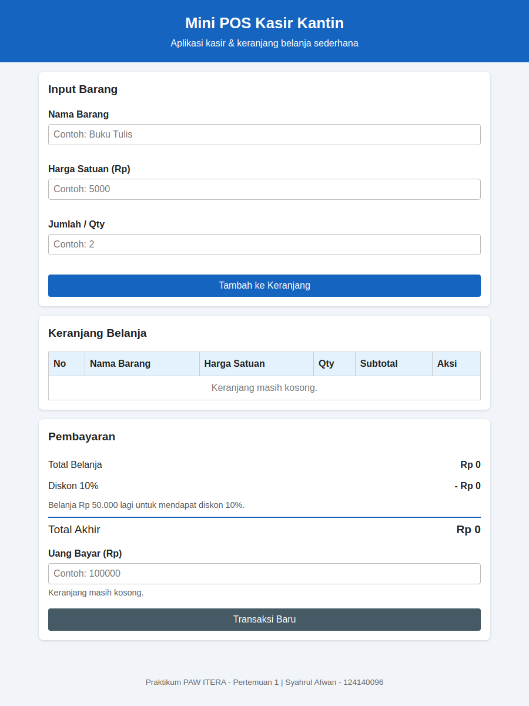
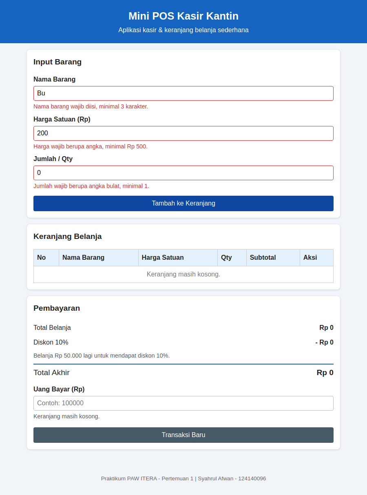
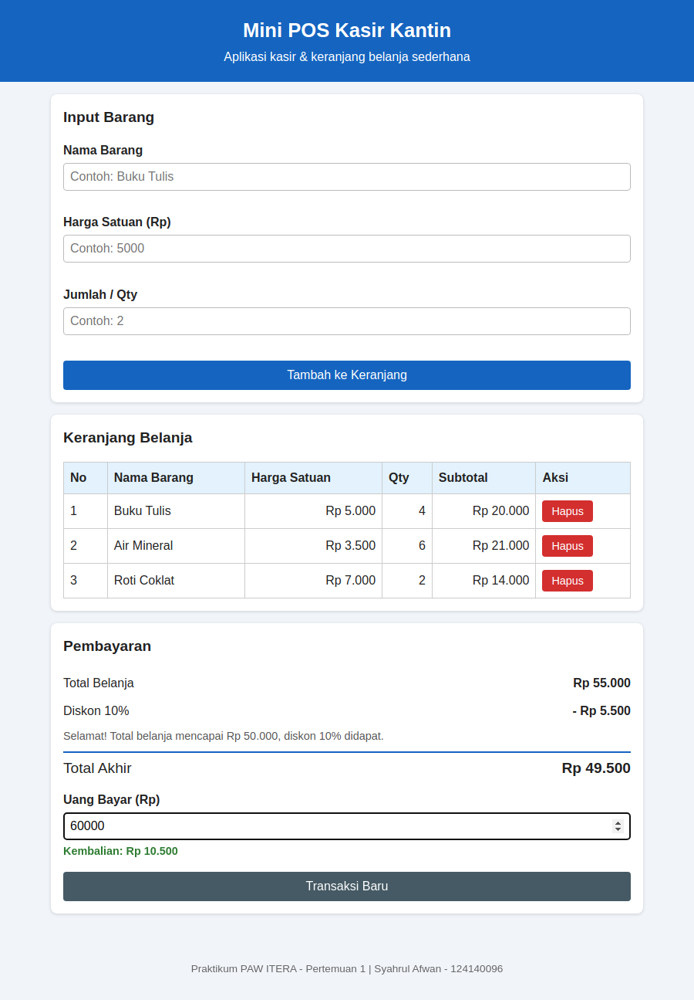

# Mini POS - Kasir & Keranjang Belanja Sederhana

Tugas Praktikum Pengembangan Aplikasi Web (PAW) - Pertemuan 1: JavaScript Dasar

## Identitas

| | |
|---|---|
| **Nama Lengkap** | Syahrul Afwan |
| **NIM** | 124140096 |
| **Kelas Praktikum** | RA |

## Deskripsi Aplikasi

Mini POS adalah aplikasi web sederhana untuk kasir kantin atau toko kampus. Kasir dapat memasukkan barang belanja (nama, harga satuan, dan jumlah), melihat daftar belanja dalam bentuk tabel, mendapatkan total belanja beserta diskon otomatis, lalu menghitung kembalian dari uang yang dibayarkan pembeli.

Tujuan pembuatan aplikasi ini adalah menerapkan materi JavaScript Dasar, yaitu variabel, kondisional, loop, fungsi, event handler, array, objek, manipulasi DOM, dan `localStorage`. Studi kasus yang dipilih adalah **kasir kantin kampus**.

## Panduan Menjalankan

1. Download atau clone repository ini.
2. Buka folder `syahrulafwan_124140096_pertemuan1` di VS Code.
3. Klik kanan `index.html`, lalu pilih **Open with Live Server** (extension *Live Server* harus terpasang).
4. Aplikasi terbuka di browser, biasanya di `http://127.0.0.1:5500`.

Alternatif: buka file `index.html` langsung di browser dengan klik dua kali.

Latihan selama praktikum ada di folder `modul/`. Buka `modul/index.html` untuk melihat daftar latihannya.

## Daftar Fitur

**Validasi form input barang**
- [x] Nama barang wajib diisi, minimal 3 karakter
- [x] Harga satuan wajib angka, minimal Rp 500
- [x] Qty wajib angka bulat, minimal 1
- [x] Pesan error merah di bawah input yang salah, dan barang tidak masuk keranjang jika ada yang salah
- [x] Form otomatis di-reset jika data valid

**Kalkulator dan perhitungan otomatis**
- [x] Subtotal per barang (harga satuan x qty)
- [x] Total belanja dari seluruh subtotal
- [x] Diskon 10% otomatis jika total belanja minimal Rp 50.000
- [x] Nominal diskon dan total akhir ditampilkan
- [x] Input uang bayar, kembalian dihitung otomatis
- [x] Keterangan "uang belum mencukupi" jika uang bayar kurang

**Keranjang belanja dan localStorage**
- [x] Tabel keranjang (No, Nama Barang, Harga Satuan, Qty, Subtotal, Aksi)
- [x] Tombol Hapus di setiap baris, total dan diskon terhitung ulang otomatis
- [x] Keranjang disimpan ke `localStorage` (`JSON.stringify`) dan dimuat ulang (`JSON.parse`), sehingga tidak hilang saat halaman di-refresh
- [x] Tombol **Transaksi Baru** untuk mengosongkan keranjang dan `localStorage`
- [x] Format angka dalam Rupiah dan tampilan responsif

## Tangkapan Layar

Berikut beberapa tampilan aplikasi Mini POS.

<table>
  <tr>
    <td align="center" width="33%"><strong>1. Form Input</strong></td>
    <td align="center" width="33%"><strong>2. Validasi Error</strong></td>
    <td align="center" width="33%"><strong>3. Hasil Perhitungan</strong></td>
  </tr>
  <tr>
    <td align="center" width="33%"></td>
    <td align="center" width="33%"></td>
    <td align="center" width="33%"></td>
  </tr>
</table>

## Penjelasan Teknis Singkat

### Struktur File

| File | Fungsi |
|---|---|
| `index.html` | Struktur halaman: form, tabel keranjang, dan bagian pembayaran |
| `style.css` | Tampilan antarmuka |
| `script.js` | Seluruh logika aplikasi |
| `modul/` | Latihan selama praktikum |

### 1. Penanganan validasi input

Fungsi `validasiForm()` dipanggil saat tombol **Tambah ke Keranjang** diklik. Fungsi ini membaca nilai input, lalu memeriksanya dengan operator ternary:

- nama: `trim()` lalu cek `length < 3`
- harga: `parseFloat()` lalu cek `isNaN(harga) || harga < 500`
- qty: `parseFloat()` lalu cek `isNaN(qty) || qty < 1 || qty % 1 !== 0` (harus bilangan bulat)

Hasil pemeriksaan berupa teks pesan error (kosong jika input benar) yang ditampilkan oleh fungsi `setError()` di elemen `
` di bawah input. Jika ada yang salah, fungsi mengembalikan `false`, sehingga `tambahBarang()` berhenti dan barang tidak masuk ke keranjang. Jika semua benar, barang disimpan sebagai objek `{ nama, harga, qty }` ke array `keranjang` dengan `push()`, lalu form di-reset.

### 2. Algoritma kalkulator

Semua perhitungan ada di fungsi `hitungRingkasan()`:

- **Subtotal:** `harga * qty` untuk setiap barang
- **Total belanja:** `reduce()` menjumlahkan semua subtotal
- **Diskon:** jika total >= 50.000, diskon = total x 10 / 100, selain itu 0
- **Total akhir:** total belanja - diskon
- **Kembalian:** uang bayar - total akhir (fungsi `tampilkanKembalian()`). Jika uang bayar kurang dari total akhir, ditampilkan pesan uang belum mencukupi beserta kekurangannya.

Tampilan dihitung ulang oleh `tampilkanSemua()` setiap kali barang ditambah, dihapus, direset, atau saat uang bayar diketik.

### 3. Mekanisme serialisasi localStorage

`localStorage` hanya dapat menyimpan teks, sehingga array `keranjang` diubah dulu menjadi teks JSON:

- **Menyimpan:** `localStorage.setItem("keranjangBelanja", JSON.stringify(keranjang))` dipanggil oleh `simpanKeranjang()` setiap barang ditambah atau dihapus.
- **Memuat:** saat halaman dibuka, `JSON.parse(localStorage.getItem("keranjangBelanja"))` mengembalikan teks menjadi array. Jika belum ada data, keranjang dimulai dari array kosong `[]`.
- **Reset:** `localStorage.removeItem("keranjangBelanja")` dipanggil oleh tombol **Transaksi Baru**.
