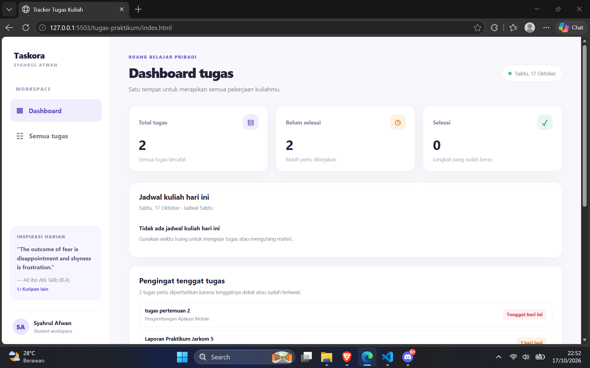
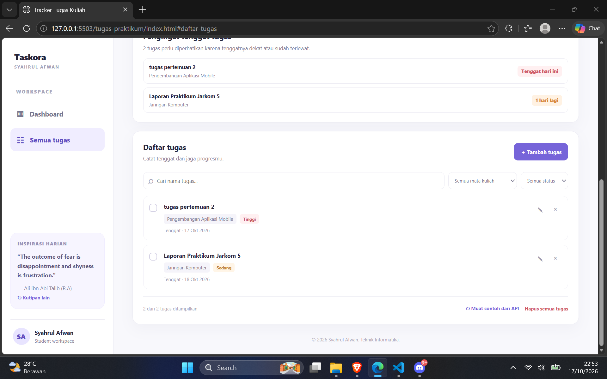
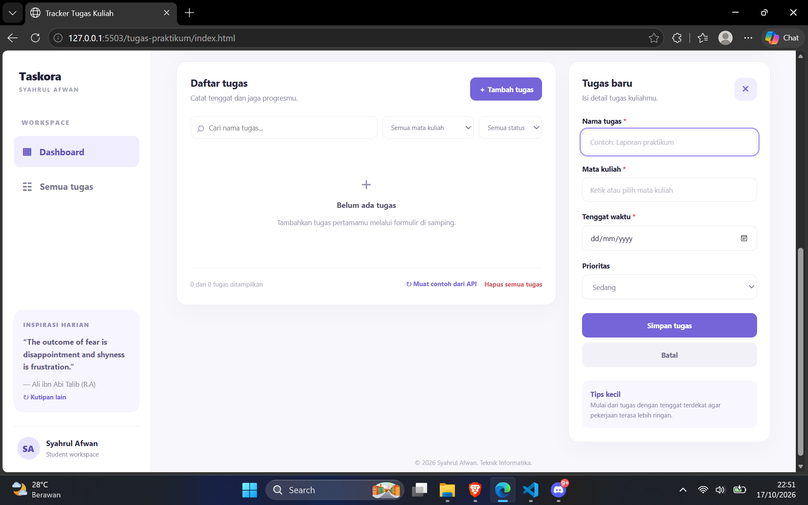
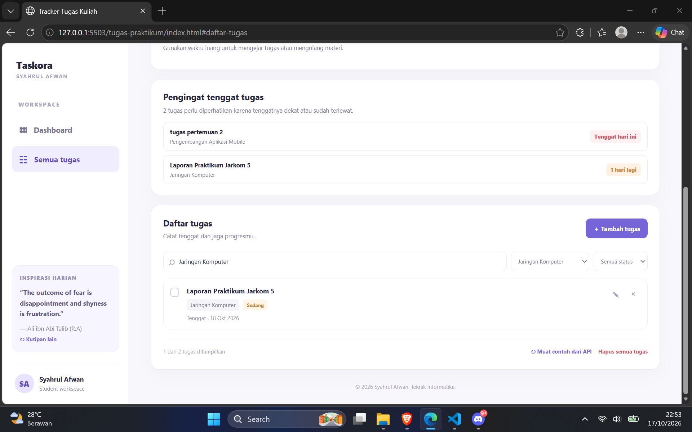
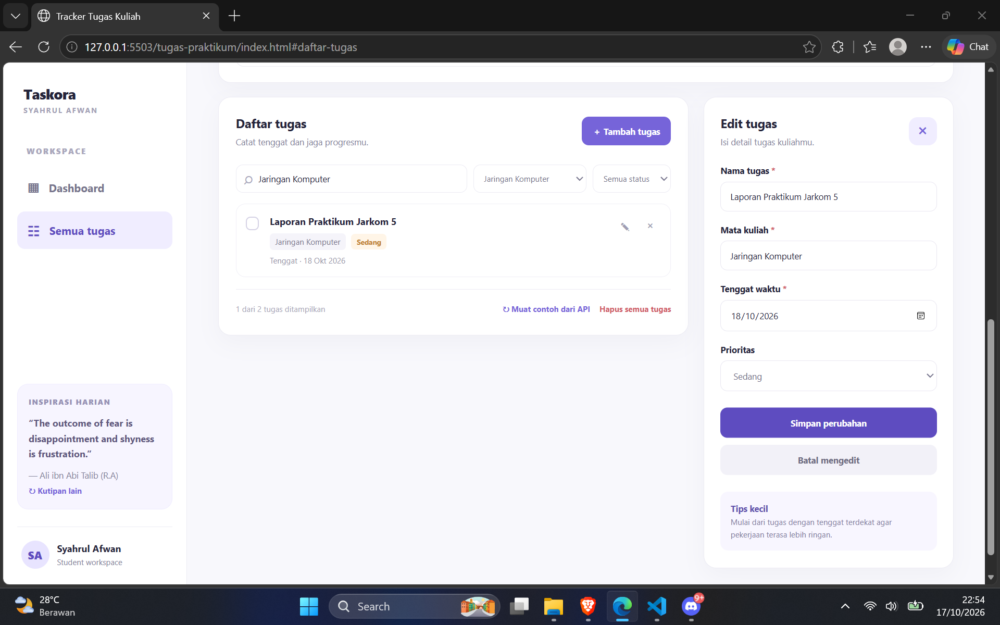
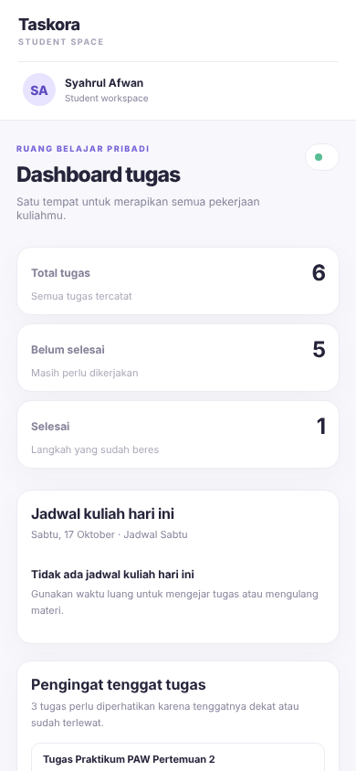

# Taskora — Tracker Tugas Kuliah

Tugas Praktikum Pertemuan 2: **Personal Dashboard** (JavaScript Next Gen / ES6+)

| Keterangan | Isi           |
| ---------- | ------------- |
| Nama       | Syahrul Afwan |
| NIM        | 124140096     |
| Kelas      | RA            |

## Tentang Aplikasi

Taskora adalah aplikasi pencatat tugas kuliah untuk kebutuhan mahasiswa sehari-hari. Dalam satu halaman, pengguna bisa mencatat tugas, memantau tenggat, dan melihat jadwal kuliah hari ini. Data tugas disimpan di `localStorage`, jadi tidak hilang saat halaman dimuat ulang.

## Fitur Aplikasi

**Kelola tugas**

- Tambah, edit, dan hapus tugas (nama, mata kuliah, tenggat, prioritas).
- Tandai tugas selesai atau belum selesai.
- Formulir tersembunyi, muncul saat klik **Tambah tugas** atau saat edit, dan menutup lagi setelah disimpan atau dibatalkan.

**Pencarian dan filter**

- Cari nama tugas.
- Filter berdasarkan mata kuliah dan status.

**Ringkasan**

- Jumlah total, belum selesai, dan selesai.
- Pengingat tenggat: tugas yang jatuh tempo dalam 3 hari (atau terlambat) tampil di bagian atas.
- Jadwal kuliah harian sesuai hari berjalan.

**Tampilan**

- Daftar menampilkan 4 tugas pertama, sisanya dibuka lewat tombol **Selengkapnya**.
- Sidebar tetap (sticky) saat halaman di-scroll.
- Responsif untuk desktop dan HP.

**Data**

- Data tugas disimpan di `localStorage`, jadi tidak hilang saat halaman dimuat ulang.
- Kutipan harian dari DummyJSON Quotes (ada kutipan cadangan jika API gagal).
- Tombol **Muat contoh dari API** untuk mengambil tugas contoh dari JSONPlaceholder.

Filter mata kuliah mengikuti jadwal semester ini: Kapita Selekta, Inteligensi Buatan, Pengembangan Aplikasi Web, Keamanan Siber, Metodologi Penelitian, Jaringan Komputer, Sistem Informasi, dan Pengembangan Aplikasi Mobile. Nama lama "Jarkom" otomatis digabung ke Jaringan Komputer.

## Screenshot

Tugas pada screenshot adalah data contoh yang dimasukkan lewat form aplikasi.

### 1. Dashboard

<p align="center">
  
</p>

### 2. Daftar tugas dan sidebar yang tetap terlihat saat scroll

<p align="center">
  
</p>

### 3. Formulir tambah tugas baru

<p align="center">
  
</p>

### 4. Pencarian dan filter tugas

<p align="center">
  
</p>

### 5. Mode edit tugas

<p align="center">
  
</p>

### 6. Tampilan mobile

<p align="center">
  
</p>

## Fitur ES6+ yang Digunakan

Nomor baris mengacu pada `js/modules/DashboardApp.js`, kecuali disebutkan lain.

| Fitur ES6+                           | Lokasi (baris)                                                                                    | Contoh                                                                     |
| ------------------------------------ | ------------------------------------------------------------------------------------------------- | -------------------------------------------------------------------------- |
| `let` dan `const`                    | L6-L10 (`const` untuk nilai tetap), L44 (`let changed` karena nilainya berubah)                   | `const STORAGE_KEY = ...`, `let changed = false`                           |
| Arrow functions (lebih dari 3)       | L24, L55-L59, L69, L78, L101, L179-L182; `helpers.js` L1-L4; `views.js` L5, L9                    | `(event) => this.handleSubmit(event)`                                      |
| Template literals                    | L143, L159, L173, L185, L226, L243, L255; `views.js` L7-L19, L26, L30, L33, L36-L38               | `` `Hapus tugas \"${task.name}\"?` ``                                      |
| Async/await                          | L232 (`loadApiSamples`, await di L237 dan L240), L264 (`loadDailyQuote`, await di L273 dan L275)  | `const response = await fetch(...)`                                        |
| Classes                              | `TaskItem.js` L3, `DashboardApp.js` L12                                                           | `export class DashboardApp { ... }`                                        |
| Destructuring pada parameter fungsi  | `TaskItem.js` L4; L78, L85, L181, L241-L242, L280; `views.js` L29, L35                            | `constructor({ id, name, course, ... })`                                   |
| Destructuring objek dan array        | L81, L275, L281, L286; `views.js` L6, L23                                                         | `const { action, id } = button.dataset`, `const [icon, title, hint] = ...` |
| Default parameter                    | `TaskItem.js` L4; L265                                                                            | `priority = 'medium', completed = false`                                   |
| Spread pada objek (update immutable) | `TaskItem.js` L27 dan L31; L106                                                                   | `new TaskItem({ ...this, ...changes })`                                    |
| Spread pada array state (immutable)  | L72, L106, L114, L194, L252                                                                       | `this.tasks = [...this.tasks, ...samples]`                                 |
| `try/catch/finally`                  | L22-L27, L236-L261, L272-L290                                                                     | `try { ... } catch { ... } finally { ... }`                                |
| Modules (`import` / `export`)        | `DashboardApp.js` L1-L4 dan L12; `TaskItem.js` L3; `data.js`, `helpers.js`, `views.js`, `main.js` | `import { TaskItem } from './TaskItem.js'`                                 |
| Method array modern                  | L24, L112, L144, L179-L182, L207-L210, L218                                                       | `map`, `filter`, `find`, `some`, `sort`                                    |

## Struktur Folder

```text
syahrulafwan_124140096_pertemuan02/
├── README.md
├── index.html
├── css/
│   └── style.css
├── js/
│   ├── main.js
│   └── modules/
│       ├── TaskItem.js
│       ├── DashboardApp.js
│       ├── views.js
│       ├── data.js
│       └── helpers.js
├── modul/                    # latihan per topik
│   ├── 01-variables/
│   ├── 02-arrow-functions/
│   ├── 03-template-literals/
│   ├── 04-destructuring-spread/
│   ├── 05-array-methods/
│   ├── 06-async-await/
│   └── 07-classes/
└── screenshots/              # tangkapan layar aplikasi
```

## Arsitektur Kode

| File                         | Peran                                                                                                                                                                                                                     |
| ---------------------------- | ------------------------------------------------------------------------------------------------------------------------------------------------------------------------------------------------------------------------- |
| `js/main.js`                 | Entry point (`type="module"`), membuat dan menjalankan `DashboardApp`                                                                                                                                                     |
| `js/modules/TaskItem.js`     | `class TaskItem`: model satu tugas (`id`, `name`, `course`, `deadline`, `priority`, `completed`, `source`) dengan method `getPriorityLabel()`, `getDaysLeft()`, `update()` (menghasilkan `TaskItem` baru), dan `toJSON()` |
| `js/modules/DashboardApp.js` | `class DashboardApp`: mengelola state `tasks`, `localStorage`, event listener, dan `fetch()`                                                                                                                              |
| `js/modules/views.js`        | Fungsi kecil yang mengubah data menjadi HTML dengan template literals                                                                                                                                                     |
| `js/modules/data.js`         | Data tetap: daftar mata kuliah, jadwal, dan kutipan cadangan                                                                                                                                                              |
| `js/modules/helpers.js`      | Fungsi bantu: `$`, `formatDate`, `escapeHTML`, dan sebagainya                                                                                                                                                             |
| `css/style.css`              | Gaya tampilan aplikasi                                                                                                                                                                                                    |

State tidak dimutasi langsung. Perubahan dilakukan dengan `map`, `filter`, dan spread operator, lalu disimpan kembali lewat `refresh()`.

## Menjalankan Aplikasi

1. Ekstrak ZIP dan buka foldernya di VS Code.
2. Klik kanan `index.html`, lalu pilih **Open with Live Server**.
3. Jangan buka `index.html` dengan double-click, karena JavaScript Modules hanya berjalan lewat server lokal.
4. Latihan di folder `modul/` dibuka dengan cara yang sama.

## API Publik yang Digunakan

Gratis dan tanpa API key. Jika API tidak dapat diakses, aplikasi menampilkan pesan dan kutipan cadangan.

| API                                                   | Dipakai untuk                                                                                   |
| ----------------------------------------------------- | ----------------------------------------------------------------------------------------------- |
| `https://dummyjson.com/quotes?limit=0`                | Kutipan harian di sidebar. Aplikasi memilih kutipan acak yang berbeda dari kutipan terakhir.    |
| `https://jsonplaceholder.typicode.com/todos?_limit=5` | Tombol **Muat contoh dari API**: contoh tugas ditambahkan tanpa menghapus tugas yang sudah ada. |
