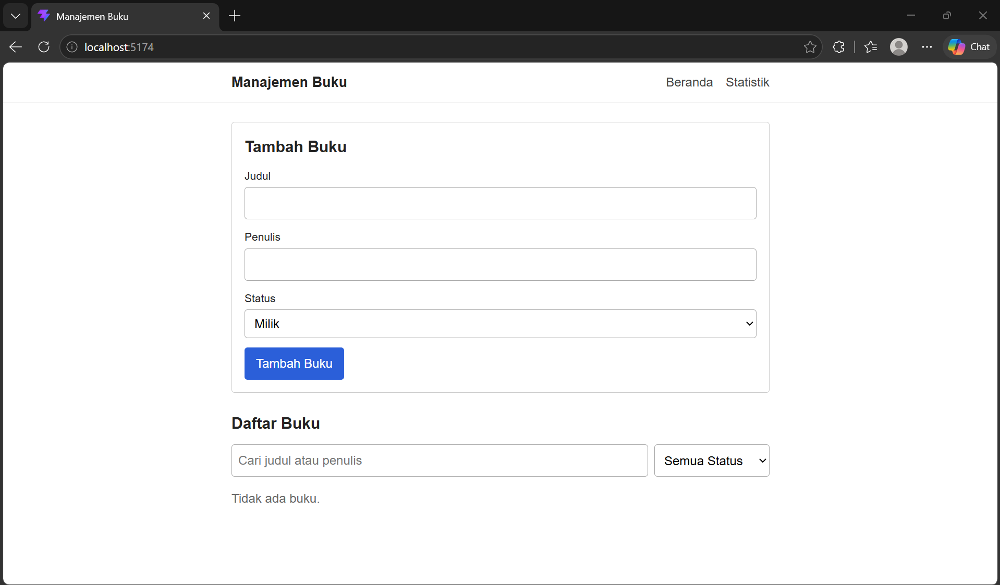
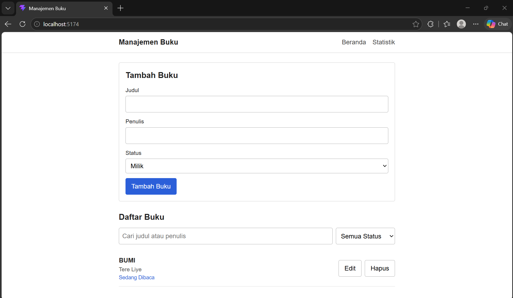
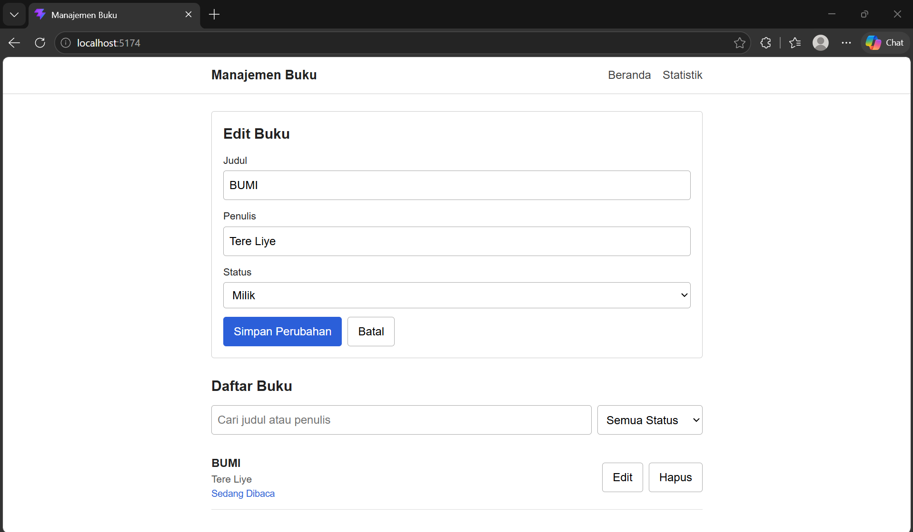
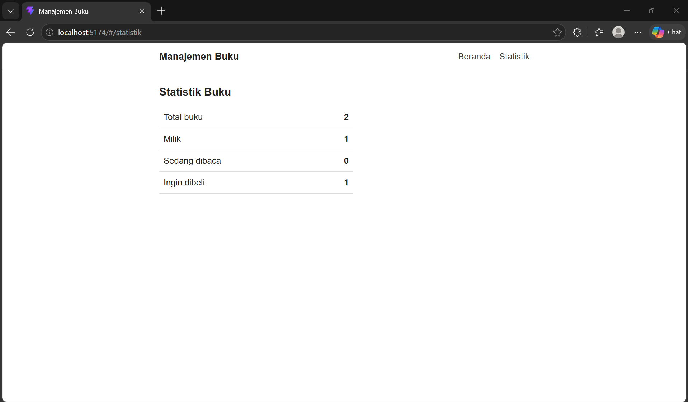
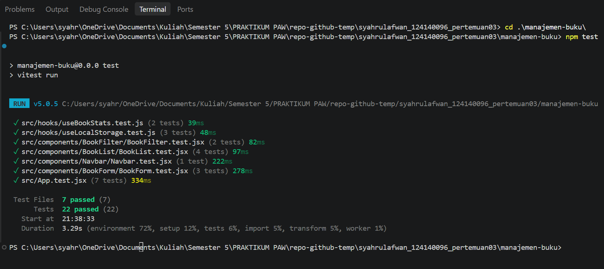

# Pertemuan 3 - React Basics

Praktikum Pengembangan Aplikasi Web (PAW) 2026/2027, Teknik Informatika ITERA

| Keterangan | Isi           |
| ---------- | ------------- |
| Nama       | Syahrul Afwan |
| NIM        | 124140096     |
| Kelas      | RA            |

## Isi Folder

```
syahrulafwan_124140096_pertemuan03/
├── index.html        halaman utama (identitas + link ke aplikasi)
├── README.md         dokumentasi ini
├── screenshots/      screenshot tampilan aplikasi dan hasil npm test
├── manajemen-buku/   TUGAS: aplikasi manajemen buku pribadi (project Vite)
└── modul/            latihan dari modul (kode dan output)
```

## Deskripsi Aplikasi

Manajemen Buku adalah aplikasi untuk mencatat buku pribadi. Setiap buku punya judul, penulis, dan status:

- Milik: buku yang sudah dimiliki
- Sedang Dibaca: buku yang sedang dibaca
- Ingin Dibeli: buku yang ingin dibeli

Fitur yang tersedia:

1. Tambah buku baru (judul, penulis, status)
2. Edit buku
3. Hapus buku
4. Filter buku berdasarkan status
5. Cari buku berdasarkan judul atau nama penulis
6. Halaman Statistik berisi jumlah buku total dan per status

Data disimpan di `localStorage`, jadi tidak hilang saat halaman di-refresh.

Form tidak bisa disimpan kalau judul atau penulis kosong. Kolom yang kosong diberi border merah dan pesan error di bawahnya.

## Cara Instalasi dan Menjalankan

Pastikan Node.js dan npm sudah terpasang.

```bash
cd manajemen-buku
npm install
npm run dev
```

Lalu buka alamat yang muncul di terminal (biasanya `http://localhost:5173`).

Perintah lain:

```bash
npm test         # menjalankan unit test (Vitest)
npm run lint     # cek kode dengan oxlint
npm run build    # build untuk produksi (hasilnya di folder dist/)
npm run preview  # coba hasil build
```

## Screenshot

Halaman Beranda (form, filter, dan daftar buku):



Validasi form saat input kosong:



Mode edit:



Halaman Statistik:



## Struktur Kode

```
manajemen-buku/src/
├── components/
│   ├── BookForm/      form tambah dan edit buku
│   ├── BookList/      daftar buku + tombol edit dan hapus
│   ├── BookFilter/    kolom cari dan filter status
│   └── Navbar/        navigasi antar halaman
├── pages/
│   ├── Home/          halaman utama
│   └── Stats/         halaman statistik
├── hooks/
│   ├── useLocalStorage.js
│   └── useBookStats.js
├── context/
│   └── BookContext.jsx
├── constants.js       daftar status buku
├── App.jsx
├── App.css            gaya umum (reset dan font)
├── main.jsx
└── setupTests.js
```

Tiap komponen punya file `.jsx` dan `.css` sendiri, sesuai struktur yang disarankan di modul.

## Fitur React yang Digunakan

### useState dan useEffect

- `useState` dipakai di `BookForm` (isi input dan pesan error), di `Home` (kata pencarian, filter status, dan buku yang sedang diedit), dan di `useLocalStorage`.
- `useEffect` dipakai di `useLocalStorage` untuk menyimpan data ke `localStorage` setiap kali datanya berubah.

### Komponen reusable

`BookForm`, `BookList`, `BookFilter`, dan `Navbar`. Komponen-komponen ini menerima data lewat props dan tidak menyimpan data buku sendiri, jadi bisa dipakai ulang. `BookForm` misalnya dipakai untuk tambah dan edit, bedanya hanya di prop `bookToEdit`.

### Context API

`BookContext.jsx` menyimpan daftar buku dan fungsi `addBook`, `updateBook`, `deleteBook`. Halaman Home dan Stats mengambil datanya lewat `useBooks()` tanpa perlu dikirim lewat props berlapis.

### React Router

Ada dua halaman: Beranda (`/`) dan Statistik (`/statistik`). Navigasi memakai `Link` di `Navbar`. Routernya `HashRouter` supaya halaman tidak 404 saat di-refresh di GitHub Pages.

### Custom Hook

- `useLocalStorage(key, initialValue)`: seperti `useState`, tapi nilainya dibaca dan disimpan ke `localStorage`.
- `useBookStats(books)`: menghitung jumlah buku total dan per status, dipakai di halaman Statistik.

### PropTypes

Semua komponen yang menerima props memakai PropTypes (`BookForm`, `BookList`, `BookFilter`, `Navbar`, dan `BookProvider`). Halaman `Home` dan `Stats` tidak menerima props, jadi tidak ada yang perlu dicek.

### Validasi form

Fungsi `validate()` di `BookForm` memeriksa judul dan penulis. Kalau kosong, pesan error muncul dan data tidak disimpan.

## Laporan Testing

Unit test memakai Vitest dan React Testing Library. Hasil: 7 file test, 22 test, semuanya lolos.

| File test                 | Jumlah | Yang diuji                                                           |
| ------------------------- | ------ | -------------------------------------------------------------------- |
| `BookForm.test.jsx`       | 3      | pesan error saat kosong, submit data benar, mode edit                |
| `BookList.test.jsx`       | 4      | tampil data, daftar kosong, tombol hapus, tombol edit                |
| `BookFilter.test.jsx`     | 2      | ketik di kolom cari, pilih status                                    |
| `Navbar.test.jsx`         | 1      | judul dan link navigasi                                              |
| `useLocalStorage.test.js` | 3      | nilai awal, baca data tersimpan, simpan saat berubah                 |
| `useBookStats.test.js`    | 2      | hitung per status, daftar kosong                                     |
| `App.test.jsx`            | 7      | tambah, edit, hapus, filter, cari, halaman Statistik, pindah halaman |

Screenshot hasil `npm test`:


