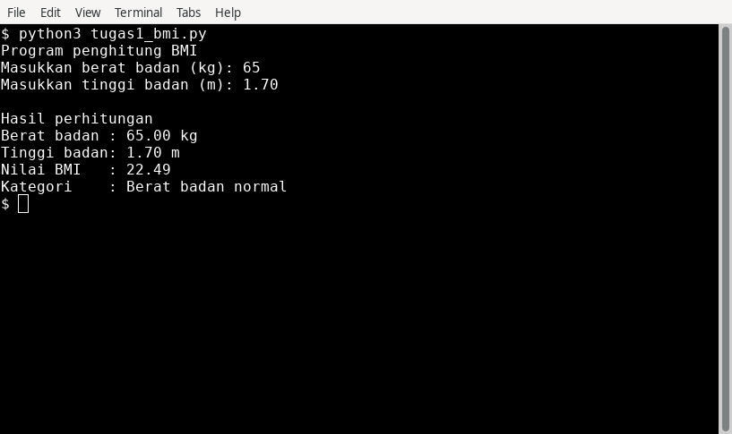
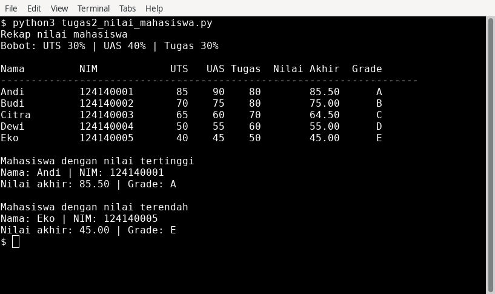
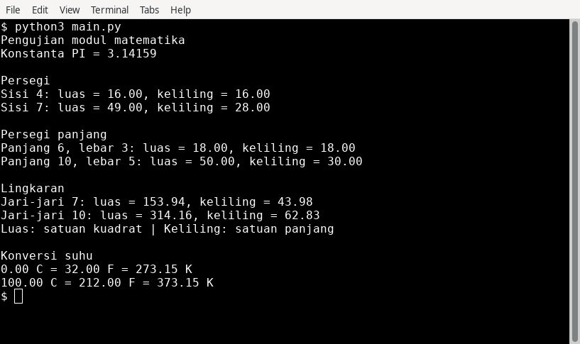

# Praktikum PAW — Pertemuan 4: Python Dasar

## Identitas

- Nama: Syahrul Afwan
- NIM: 124140096
- Program Studi: Teknik Informatika
- Institusi: Institut Teknologi Sumatera

## Deskripsi

Tiga tugas praktikum ini menerapkan variabel, operator, input/output,
percabangan, perulangan, fungsi, list, dictionary, dan modul Python.
Program berjalan melalui terminal dan tidak memerlukan paket eksternal.
Data mahasiswa pada tugas 2 merupakan data contoh, bukan data akademik asli.

## Isi folder

| Berkas/folder | Kegunaan |
| --- | --- |
| `tugas1_bmi.py` | Menghitung BMI dan menentukan kategori berat badan |
| `tugas2_nilai_mahasiswa.py` | Menghitung nilai akhir, grade, serta nilai tertinggi dan terendah |
| `math_operations.py` | Modul delapan fungsi geometri dan konversi suhu serta konstanta `PI` |
| `main.py` | Program pemanggil seluruh fungsi modul matematika |
| `dokumentasi/` | Screenshot terminal dan salinan teks hasil eksekusi ketiga tugas |
| `.gitignore` | Mengecualikan lingkungan virtual dan cache Python dari Git |

## Cara menjalankan di VS Code

1. Ekstrak ZIP, lalu buka folder `syahrulafwan_124140096_pertemuan4`
   melalui **File → Open Folder** di VS Code.
2. Pastikan Python 3 sudah terpasang. Buka **Terminal → New Terminal**
   dan periksa dengan `python --version`.
3. Jalankan setiap program secara terpisah:

```bash
python tugas1_bmi.py
python tugas2_nilai_mahasiswa.py
python main.py
```

Jika perintah `python` tidak tersedia, gunakan `python3` (misalnya di Linux/macOS)
atau `py` di Windows. Screenshot dokumentasi menggunakan `python3`.
Jalankan perintah dari folder yang sama dengan keempat berkas Python.
`math_operations.py` digunakan melalui `main.py`, sehingga tidak perlu dijalankan sendiri.
Tidak perlu menjalankan `pip install`.

## Tugas 1 — Penghitung BMI (30%)

**Alur:** membaca berat (kg) dan tinggi (m) menggunakan `float(input())`,
memastikan keduanya positif, menghitung BMI, lalu menentukan kategori dengan
`if-elif-else`. Nilai BMI dicetak dengan f-string dua angka desimal.

```text
BMI = berat / (tinggi * tinggi)
```

| Nilai BMI | Kategori |
| --- | --- |
| BMI < 18.5 | Berat badan kurang |
| 18.5 ≤ BMI < 25 | Berat badan normal |
| 25 ≤ BMI < 30 | Berat badan berlebih |
| BMI ≥ 30 | Obesitas |

- `hitung_bmi(berat, tinggi)`: mengembalikan hasil rumus BMI.
- `tentukan_kategori(bmi)`: mengembalikan kategori sesuai batas pada soal.
- `main()`: membaca input dan menampilkan hasil.

Masukkan angka dengan titik sebagai pemisah desimal, misalnya `1.70`.
Program mengasumsikan input berupa angka; input nol atau negatif ditolak
sebelum pembagian. Kategori ditentukan dari BMI asli, sebelum pembulatan tampilan.

**Contoh:** berat `65` kg dan tinggi `1.70` m menghasilkan BMI `22.49`,
dengan kategori **Berat badan normal**.



## Tugas 2 — Pengelolaan Nilai Mahasiswa (40%)

**Alur:** membuat list berisi lima dictionary. Setiap dictionary memiliki
`nama`, `nim`, `nilai_uts`, `nilai_uas`, dan `nilai_tugas`. Perulangan menghitung
nilai akhir dan menambahkan `nilai_akhir` serta `grade` ke setiap dictionary.
Program mencetak tabel dengan perataan f-string, lalu membandingkan setiap
nilai untuk mencari mahasiswa dengan nilai tertinggi dan terendah.

```text
Nilai akhir = (0.30 * UTS) + (0.40 * UAS) + (0.30 * Tugas)
```

| Nilai akhir | Grade |
| --- | --- |
| ≥ 80 | A |
| 70 ≤ nilai < 80 | B |
| 60 ≤ nilai < 70 | C |
| 50 ≤ nilai < 60 | D |
| < 50 | E |

- `hitung_nilai_akhir(nilai_uts, nilai_uas, nilai_tugas)`: menghitung nilai berbobot.
- `tentukan_grade(nilai_akhir)`: mengembalikan grade A–E.
- `main()`: menyiapkan data, menghitung nilai, mencetak tabel, dan mencari ekstrem.

| Nama | NIM contoh | UTS | UAS | Tugas | Nilai akhir | Grade |
| --- | --- | ---: | ---: | ---: | ---: | :---: |
| Andi | 124140001 | 85 | 90 | 80 | 85.50 | A |
| Budi | 124140002 | 70 | 75 | 80 | 75.00 | B |
| Citra | 124140003 | 65 | 60 | 70 | 64.50 | C |
| Dewi | 124140004 | 50 | 55 | 60 | 55.00 | D |
| Eko | 124140005 | 40 | 45 | 50 | 45.00 | E |

Nilai tertinggi: **Andi, 85.50 (A)**. Nilai terendah: **Eko, 45.00 (E)**.
Jika terdapat nilai ekstrem yang sama, program menampilkan mahasiswa pertama
pada list yang memiliki nilai tersebut.



## Tugas 3 — Modul Matematika (30%)

**Alur:** `math_operations.py` menyediakan konstanta `PI = 3.14159`
dan delapan fungsi. `main.py` memanggil semuanya menggunakan dua contoh input
untuk setiap fungsi, lalu menampilkan hasil dengan dua angka desimal.
Parameter ukuran bangun menggunakan nilai positif dalam satuan yang sama.

| Fungsi pada modul | Rumus | Input pengujian |
| --- | --- | --- |
| `luas_persegi(sisi)` | sisi × sisi | 4 dan 7 |
| `keliling_persegi(sisi)` | 4 × sisi | 4 dan 7 |
| `luas_persegi_panjang(panjang, lebar)` | panjang × lebar | (6, 3) dan (10, 5) |
| `keliling_persegi_panjang(panjang, lebar)` | 2 × (panjang + lebar) | (6, 3) dan (10, 5) |
| `luas_lingkaran(jari_jari)` | PI × jari_jari² | 7 dan 10 |
| `keliling_lingkaran(jari_jari)` | 2 × PI × jari_jari | 7 dan 10 |
| `celsius_ke_fahrenheit(celsius)` | Celsius × 9/5 + 32 | 0 dan 100 |
| `celsius_ke_kelvin(celsius)` | Celsius + 273.15 | 0 dan 100 |

Dua cara impor di `main.py`:

```python
import math_operations
from math_operations import celsius_ke_fahrenheit, celsius_ke_kelvin
```

Fungsi geometri diakses melalui `math_operations.nama_fungsi()`, sedangkan
fungsi suhu dipanggil langsung. Fungsi `main()` mengatur pengujian dan keluaran.
Semua fungsi memiliki docstring yang menjelaskan input dan nilai kembaliannya.



## Dokumentasi dan pemeriksaan

Screenshot di atas diambil dari terminal saat program dijalankan.
Salinan keluaran teks tersedia pada `dokumentasi/tugas1_bmi_output.txt`,
`dokumentasi/tugas2_nilai_mahasiswa_output.txt`, dan `dokumentasi/main_output.txt`.

Program telah diperiksa untuk batas kategori BMI 18.5, 25, dan 30;
batas grade 50, 60, 70, dan 80; hasil perhitungan lima mahasiswa;
serta hasil fungsi geometri dan konversi suhu. Input BMI nol dan negatif
juga diperiksa agar tidak terjadi pembagian dengan nol.

## Penempatan di repositori

Gunakan repositori `pemrograman_web_itera_124140096`, kemudian letakkan folder
`syahrulafwan_124140096_pertemuan4` beserta seluruh isinya di dalam repositori.
Sertakan folder `dokumentasi` agar gambar README tampil di GitHub.
Folder `venv/`, `.venv/`, dan `__pycache__/` tidak disertakan.

## Acuan

[Modul PAW ITERA — Pertemuan 4: Python Dasar](https://praktikum-paw20262027.vercel.app/pertemuan/4#dasar-teori)
