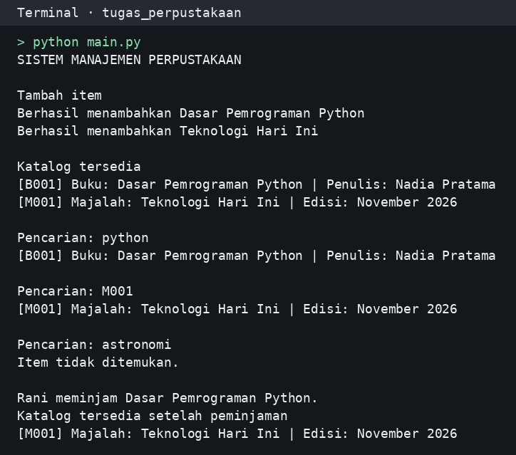

# Praktikum PAW Pertemuan 5 – Python OOP

**Nama:** Syahrul Afwan  
**NIM:** 124140096  
**Kelas:** RA

## Isi folder

- `latihan/` berisi 13 gambar output terminal dari tujuh hands-on dan enam latihan mandiri.
- `tugas_perpustakaan/` berisi `library_item.py`, `member.py`, `library.py`, dan `main.py`.
- `screenshots/` berisi gambar hasil eksekusi demo perpustakaan.

## Sistem Manajemen Perpustakaan

Program menambah buku dan majalah, menampilkan katalog yang tersedia, dan mencari item berdasarkan ID atau bagian judul. Demo juga memperlihatkan bahwa buku yang dipinjam tidak tampil di katalog tersedia.

| Konsep | Penerapan |
| --- | --- |
| Class dan object | `Library` mengelola koleksi objek `Book` dan `Magazine`. |
| Abstraction dan inheritance | `LibraryItem` menetapkan kontrak `get_detail()`. `Book` dan `Magazine` mewarisi atribut dan pengelolaan status pinjam. |
| Encapsulation | `Library` menyimpan `__koleksi` secara internal. Status pinjam dibaca melalui `@property is_dipinjam` dan diubah lewat method. |
| Polymorphism | Katalog dan hasil pencarian memanggil `get_detail()` pada tiap item. Buku menampilkan penulis, sedangkan majalah menampilkan edisi. |

## Cara menjalankan

Gunakan Python 3.10 atau lebih baru. Dari folder pertemuan, jalankan:

```sh
cd tugas_perpustakaan
python main.py
```

Bukti eksekusi setiap latihan tersedia sebagai PNG di folder `latihan/`.

## Hasil eksekusi

Gambar berikut dirender dari hasil eksekusi `python main.py`.


